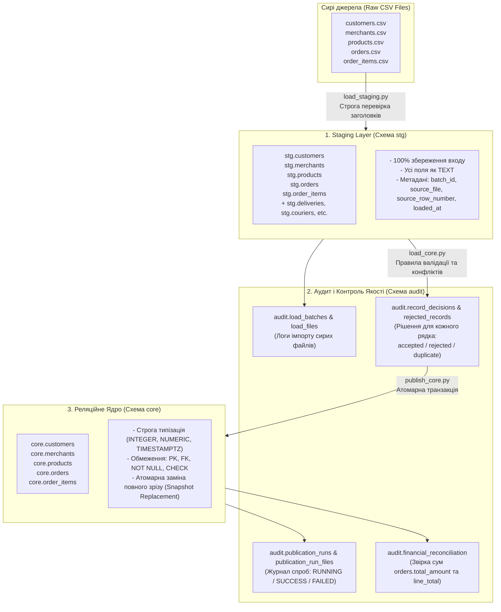
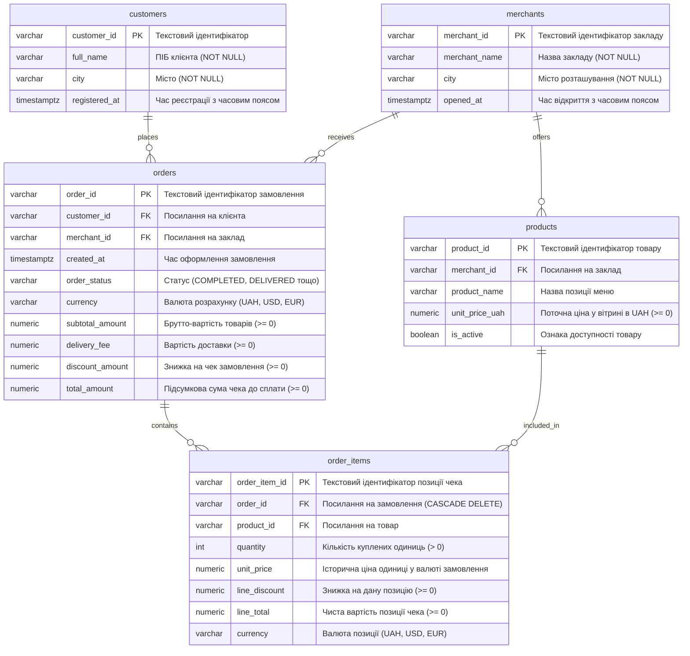

# CityFlow Data Platform (Лабораторна робота 2: Staging, Core, Публікація та Звірка)

Цей репозиторій містить повний виробничий пайплайн первинної інженерії даних для міської платформи доставки **CityFlow (Варіант S06)**.

---

## 1. Архітектура шарів даних

Архітектура реалізована за принципом багатошарового корпоративного сховища даних (ELT / Data Warehouse):



---

## 2. Системні вимоги та залежності

* **СУБД**: PostgreSQL 16+ (локальний інстанс або Docker).
* **Python**: 3.14.2 (підтримується 3.11+).
* **Ключові бібліотеки Python**:
  * `psycopg2-binary>=2.9.9` (взаємодія з PostgreSQL безпосередньо через двійковий протокол)
  * `pytest>=8.0.0` (автоматизоване тестування)

---

## 3. Налаштування середовища та конфігурація

Усі чутливі змінні конфігуруються через файл `.env` у корені проєкту (файл додано в `.gitignore`).  
Для швидкого старту доступний шаблон `.env.example`:

```bash
# Скопіювати шаблон конфігурації
cp .env.example .env
```

Зміст `.env`:
```ini
DB_NAME=cityflow_db
DB_USER=postgres
DB_PASSWORD=your_secure_password
DB_HOST=localhost
DB_PORT=5432
DATA_RAW_DIR=data/raw
```

Створення та активація віртуального оточення:
```powershell
python -m venv .venv
.venv\Scripts\Activate.ps1
pip install -r requirements.txt
```

---

## 4. Порядок відтворюваного запуску (Step-by-Step)

Для повного відтворення всього циклу з нуля дотримуйтесь наступної послідовності:

### Крок 1: Створення схем бази даних та структури таблиць
```powershell
# 1. Створення схем stg, core, audit та таблиць моніторингу
psql -U postgres -d cityflow_db -f sql/lab02/01_create_schemas.sql

# 2. Створення таблиць staging шару (всі поля TEXT + метадані)
psql -U postgres -d cityflow_db -f sql/lab02/02_create_stg_tables.sql

# 3. Створення таблиць реляційного ядра core з обмеженнями PK, FK, CHECK
psql -U postgres -d cityflow_db -f sql/lab02/03_create_core_tables.sql
```

### Крок 2: Завантаження сирих даних у Staging (Zero Record Loss)
```powershell
# Завантаження 5 основних сутностей + повного комплекту реляційних файлів
.venv\Scripts\python.exe -m src.lab02.load_staging --all-tables
```
* Перевіряє точний порядок та склад заголовків кожного CSV (fail-fast).
* Додає метадані: `batch_id`, `source_file`, `source_row_number`, `loaded_at`.
* Фіксує результати у журналі `audit.load_batches` та `audit.load_files`.

### Крок 3: Трансформація, застосування правил приймання та фіксація рішень
```powershell
.venv\Scripts\python.exe -m src.lab02.load_core
```
* Застосовує бізнес-контракт: типізація, приведення дат генератора `DD/MM/YYYY HH:MM` до UTC, усічення наносекунд до мікросекунд, валідація валют (`UAH`, `USD`, `EUR`), відхилення активних товарів з ціною $\le 0$.
* Для **кожного вхідного рядка** формує єдиний підсумковий статус (`accepted`, `rejected`, `duplicate`) та зберігає повний перелік кодів причин (`reason_codes`) і вихідний JSON payload у таблиці `audit.record_decisions`.

### Крок 4: Атомарна транзакційна публікація повного зрізу Core (Tasks 6 & 7)
```powershell
.venv\Scripts\python.exe -m src.lab02.publish_core
```
* **Порядок транзакції**:
  1. Реєстрація `RUNNING` у `audit.publication_runs` в автономній транзакції.
  2. `TRUNCATE TABLE core.order_items, core.orders, core.products, core.customers, core.merchants CASCADE`.
  3. Вставка прийнятих рядків за ієрархією: `customers/merchants` $\to$ `products/orders` $\to$ `order_items`.
  4. Проходження 4-х контрольних шлюзів (Verification Gates 1–4).
  5. Оновлення статусу на `SUCCESS` та запис журналів `audit.publication_run_files` і `audit.financial_reconciliation` $\to$ `COMMIT`.
* **Захист від збоїв (Rollback)**: У разі помилки виконується відкат, core повертається до попереднього зрізу, а статус `FAILED` з текстом помилки фіксується окремо.

### Крок 5: Виконання контрольних SQL-перевірок

Виконати 4 аналітичні перевірки можна будь-яким зручним способом:

**Варіант А (через вбудований Python runner — не потребує налаштування PATH для PostgreSQL):**
```powershell
.venv\Scripts\python.exe -m src.lab02.run_sql sql/lab02/07_control_verification_queries.sql
```

**Варіант Б (через утиліту psql з прямим шляхом):**
```powershell
& "C:\Program Files\PostgreSQL\16\bin\psql.exe" -U postgres -d cityflow_db -f sql/lab02/07_control_verification_queries.sql
```

### Крок 6: Запуск автоматизованого тестового набору
```powershell
.venv\Scripts\python.exe -m pytest -o pythonpath=. -v
```
Покриває 18 тестів: перевірка валідації, збереження рішень, транзакційна публікація, стійкість до відкатів, ідемпотентність та 4 шлюзи якості.

---

## 5. ER-діаграма реляційного ядра (Core Layer)



---

## 6. Source-to-Target Mapping (STG $\to$ CORE)

| Джерело (`stg.*`) | Цільова таблиця (`core.*`) | Цільове поле | Тип даних у Core | Бізнес-правило та трансформація |
|---|---|---|---|---|
| `stg.customers.customer_id` | `core.customers` | `customer_id` | `VARCHAR(64)` | PK; trim; обов'язкове непорожнє значення |
| `stg.customers.full_name` | `core.customers` | `full_name` | `VARCHAR(255)` | NOT NULL; trim |
| `stg.customers.city` | `core.customers` | `city` | `VARCHAR(100)` | NOT NULL; trim |
| `stg.customers.registered_at` | `core.customers` | `registered_at` | `TIMESTAMPTZ` | ISO 8601 / DD/MM/YYYY $\to$ UTC; усічення наносекунд |
| `stg.merchants.merchant_id` | `core.merchants` | `merchant_id` | `VARCHAR(64)` | PK; trim |
| `stg.merchants.merchant_name` | `core.merchants` | `merchant_name` | `VARCHAR(255)` | NOT NULL; trim |
| `stg.merchants.city` | `core.merchants` | `city` | `VARCHAR(100)` | NOT NULL; trim |
| `stg.merchants.opened_at` | `core.merchants` | `opened_at` | `TIMESTAMPTZ` | ISO 8601 / DD/MM/YYYY $\to$ UTC |
| `stg.products.product_id` | `core.products` | `product_id` | `VARCHAR(64)` | PK; trim |
| `stg.products.merchant_id` | `core.products` | `merchant_id` | `VARCHAR(64)` | FK $\to$ `merchants`; відхилення orphan-посилань |
| `stg.products.product_name` | `core.products` | `product_name` | `VARCHAR(255)` | NOT NULL; trim |
| `stg.products.unit_price_uah` | `core.products` | `unit_price_uah` | `NUMERIC(12,2)` | `CHECK >= 0`; якщо `is_active=True`, ціна $\le 0$ відхиляється |
| `stg.products.is_active` | `core.products` | `is_active` | `BOOLEAN` | Парсинг `true`/`false`/`1`/`0` |
| `stg.orders.order_id` | `core.orders` | `order_id` | `VARCHAR(64)` | PK; trim |
| `stg.orders.customer_id` | `core.orders` | `customer_id` | `VARCHAR(64)` | FK $\to$ `customers`; перевірка батька |
| `stg.orders.merchant_id` | `core.orders` | `merchant_id` | `VARCHAR(64)` | FK $\to$ `merchants`; перевірка батька |
| `stg.orders.created_at` | `core.orders` | `created_at` | `TIMESTAMPTZ` | ISO 8601 / DD/MM/YYYY $\to$ UTC |
| `stg.orders.order_status` | `core.orders` | `order_status` | `VARCHAR(50)` | NOT NULL; trim |
| `stg.orders.currency` | `core.orders` | `currency` | `VARCHAR(10)` | `CHECK IN ('UAH', 'USD', 'EUR')`; 'UA H' відхиляється |
| `stg.orders.subtotal_amount` | `core.orders` | `subtotal_amount` | `NUMERIC(12,2)` | Брутто-сума вартості товарів (до знижок) |
| `stg.orders.delivery_fee` | `core.orders` | `delivery_fee` | `NUMERIC(12,2)` | Невідоме число не замінюється нулем (NULL-safe) |
| `stg.orders.discount_amount` | `core.orders` | `discount_amount` | `NUMERIC(12,2)` | Знижка на замовлення |
| `stg.orders.total_amount` | `core.orders` | `total_amount` | `NUMERIC(12,2)` | Підсумкова сума чека; не змінюється заднім числом |
| `stg.order_items.order_item_id` | `core.order_items` | `order_item_id` | `VARCHAR(64)` | PK; trim |
| `stg.order_items.order_id` | `core.order_items` | `order_id` | `VARCHAR(64)` | FK $\to$ `orders` |
| `stg.order_items.product_id` | `core.order_items` | `product_id` | `VARCHAR(64)` | FK $\to$ `products` |
| `stg.order_items.quantity` | `core.order_items` | `quantity` | `INTEGER` | `CHECK (quantity > 0)` |
| `stg.order_items.unit_price` | `core.order_items` | `unit_price` | `NUMERIC(12,2)` | Історична ціна одиниці у валюті замовлення |
| `stg.order_items.line_discount` | `core.order_items` | `line_discount` | `NUMERIC(12,2)` | Знижка рядка (NOT NULL, default 0.00) |
| `stg.order_items.line_total` | `core.order_items` | `line_total` | `NUMERIC(12,2)` | Чиста вартість позиції `(qty * price - discount)` |
| `stg.order_items.currency` | `core.order_items` | `currency` | `VARCHAR(10)` | `CHECK IN ('UAH', 'USD', 'EUR')` |

*Примітка щодо неперенесених атрибутів:* Необов'язкові технічні та розширені атрибути (як-от `phone`, `customer_status`, `merchant_type`, `service_zone_id`, `updated_at`, `category`) зберігаються на рівні `stg.*` для запобігання втраті первинного контексту. Унікальність на email відсутня, оскільки в первинних даних зафіксовано спільні сімейні акаунти.

---

## 7. Чотири контрольні перевірки та аналіз рівня деталізації (Task 9)

Результати виконання перевірок [`sql/lab02/07_control_verification_queries.sql`](file:///c:/Users/Rabil/Desktop/%D1%83%D0%BD%D1%96%D0%BA/3%D0%BA/%D0%9C%D0%B5%D1%82%D0%BE%D0%B4%D0%B8%20%D1%82%D0%B0%20%D1%82%D0%B5%D1%85%D0%BD%D0%BE%D0%BB%D0%BE%D0%B3%D1%96%D1%97%20%D1%96%D0%BD%D0%B6%D0%B5%D0%BD%D0%B5%D1%80%D1%96%D1%97%20%D0%B4%D0%B0%D0%BD%D0%B8%D1%85/sql/lab02/07_control_verification_queries.sql):

1. **Дублікати PK**: **0 дублікатів** у всіх 5 таблицях `core`.
2. **Відсутні/розірвані FK**: **0 сирітських зв'язків** (orphan records).
3. **Звірка сум за валютами**:
   * `UAH`: Stg Orders = 3 593 078.92 == Core Orders = 3 593 078.92 (diff = 0.00); Stg Items = 3 152 245.13 == Core Items = 3 152 245.13 (diff = 0.00).
   * `USD`: Stg Orders = 720.41 == Core Orders = 720.41 (diff = 0.00); Stg Items = 631.55 == Core Items = 631.55 (diff = 0.00).
   * `EUR`: Stg Orders = 293.41 == Core Orders = 293.41 (diff = 0.00); Stg Items = 251.62 == Core Items = 251.62 (diff = 0.00).
4. **Проблема JOIN Fan-out Multiplication та рівень деталізації (Grain)**:
   * Якщо виконати `SUM(o.total_amount)` після `JOIN core.order_items oi`, сума для гривні стає **10 090 175.31 грн замість 3 593 078.92 грн** (завищення майже втричі через кардинальність $1:N$).
   * **Чому заборонено виправляти через `SUM(DISTINCT total_amount)`**: різні замовлення можуть мати ідентичні чеки (наприклад, комбо за 150 грн). `SUM(DISTINCT)` схлопує їх в одне число і «краде» понад 75 554 грн виторгу!
   * **Правильне рішення**: обчислювати суму на рівні зернистості замовлення (`Grain = Order`) або попередньо агрегувати дочірні позиції перед JOIN.

---

## 8. Відомі обмеження первинних даних (Data Diagnostics)

* **Незалежні округлення $\pm 0.01$**: у 20 замовленнях виявлено копійчані розбіжності між формулою `subtotal + delivery - discount` та чеком через незалежне округлення податків у генераторі.
* **Аномалія джерела `S06-O0000773`**: формульне значення 442.30 грн vs факт чека 579.47 грн (різниця +137.17 грн). Згідно з контрактом джерело **не змінюється заднім числом**, оскільки чек фіксує платіжний факт.
* **Поточні vs історичні ціни**: `products.unit_price_uah` представляє поточний стан вітрини в UAH; `order_items.unit_price` фіксує незмінну ціну угоди в момент покупки у валюті замовлення (UAH, USD, EUR).

---

## 9. Політика репозиторію та теги
* Повні масиви сирих CSV та бінарні дампи БД ігноруються в Git (`.gitignore`).
* Усі контрольні негативні сценарії базуються на малій синтетичній вибірці в `tests/fixtures/`.
* Для фіксації релізу версії лабораторної роботи створено тег: `lab-02-v1`.
